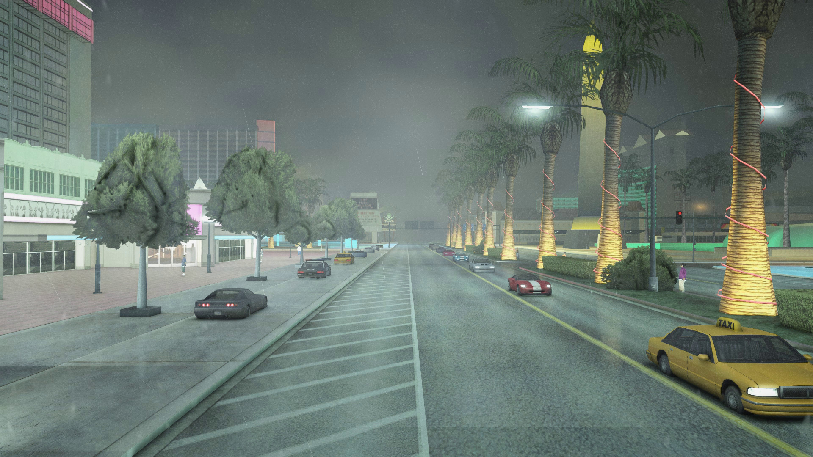
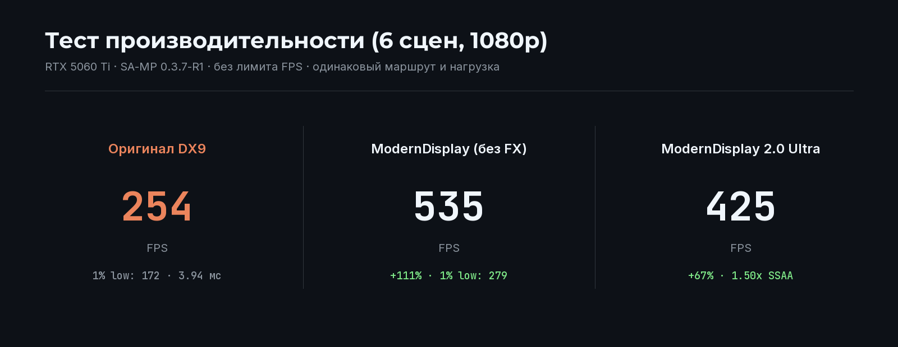
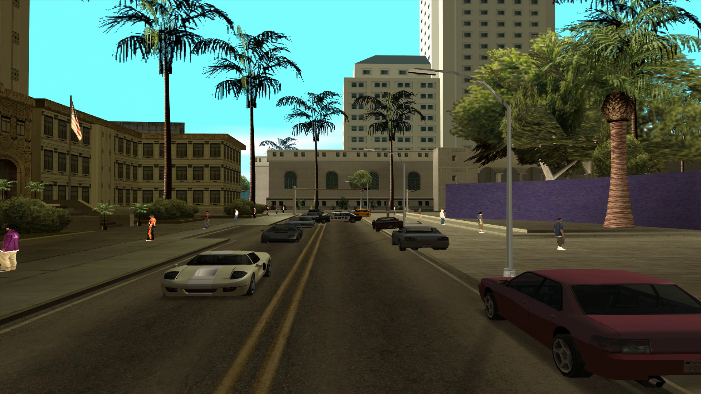
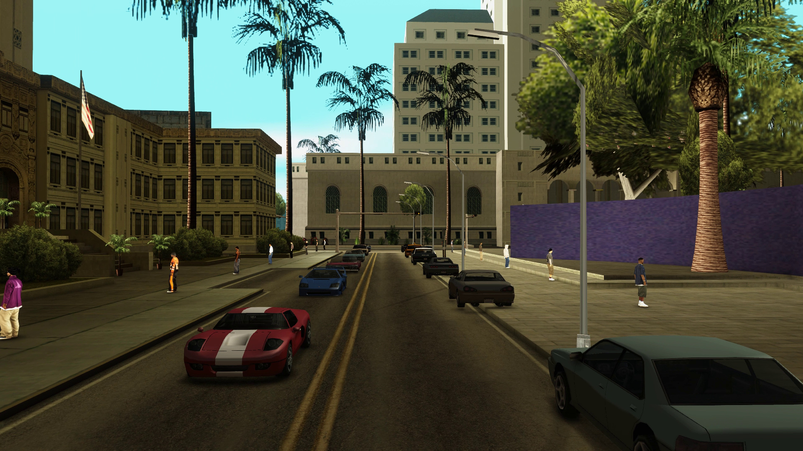
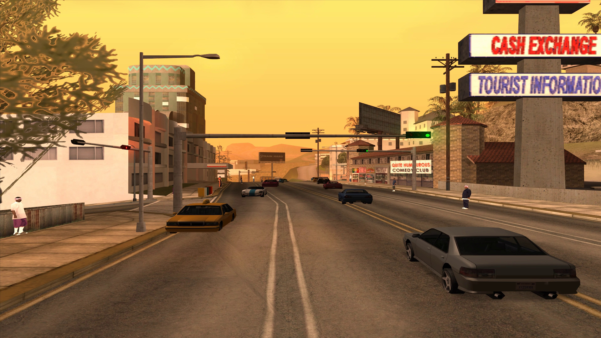
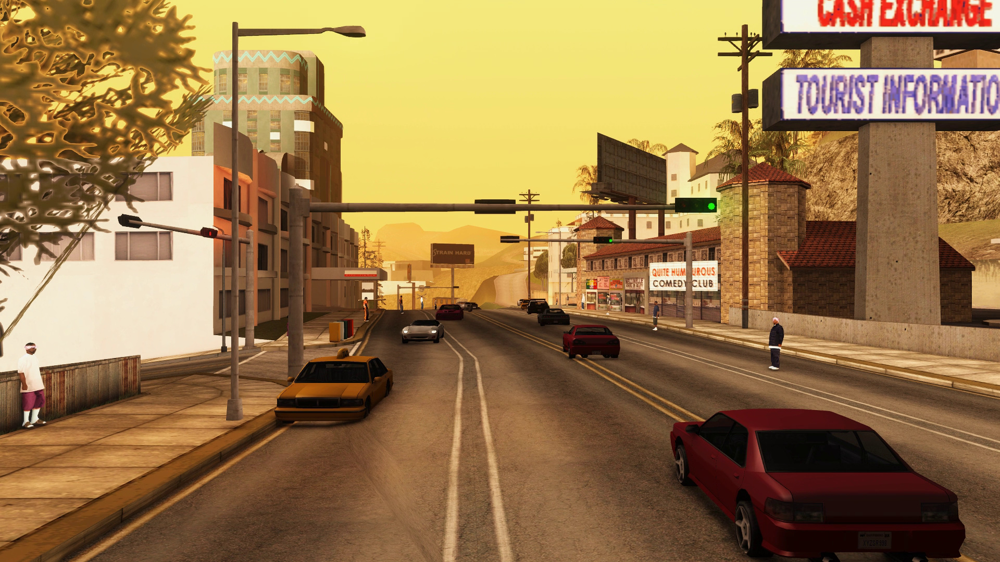
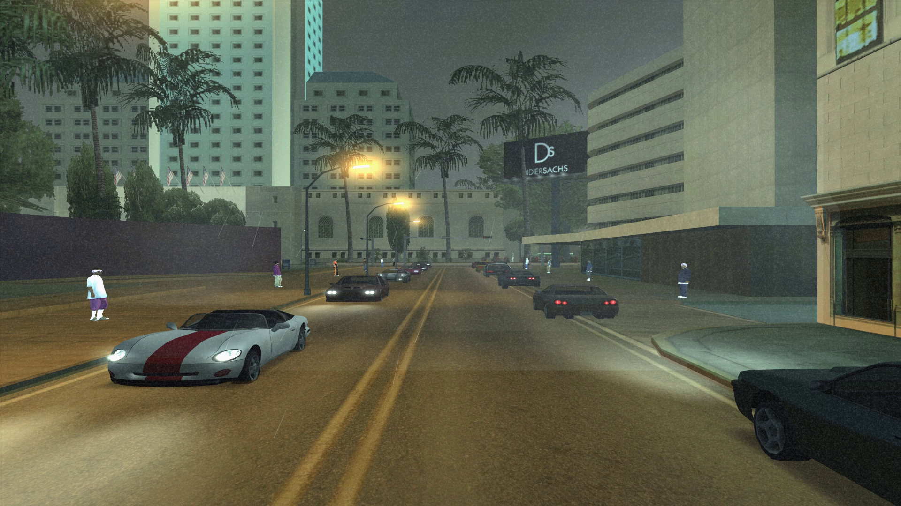
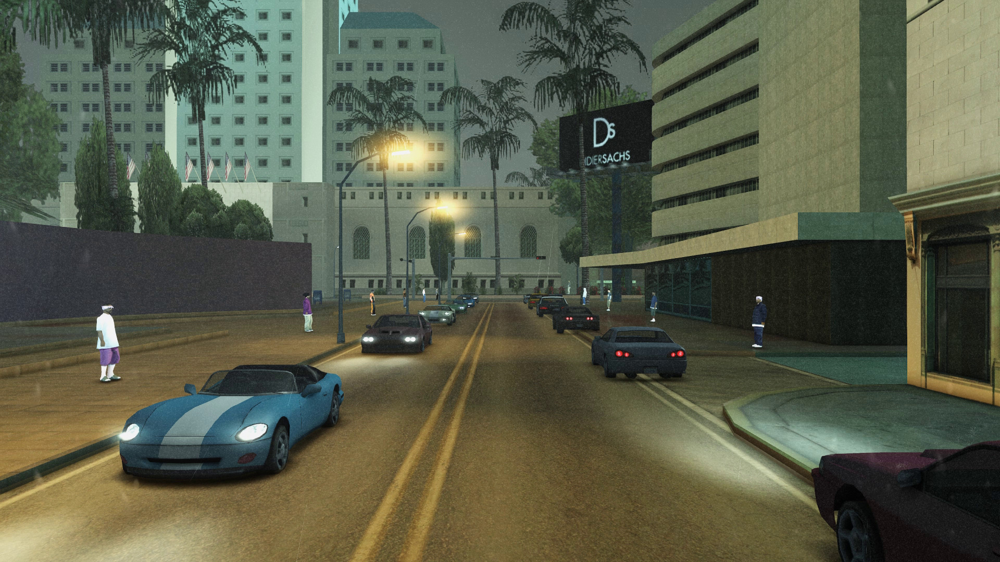
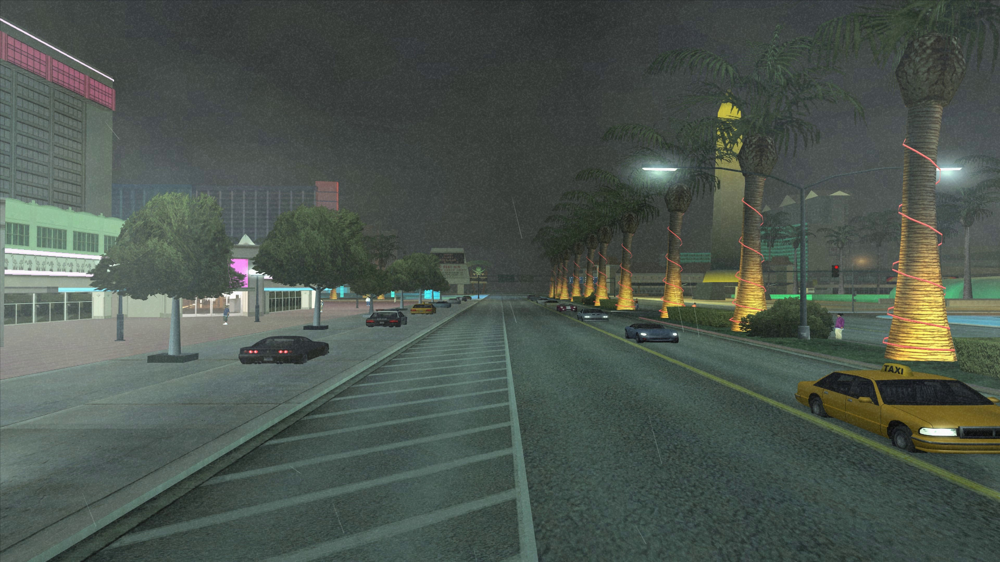

# ModernDisplay 2.0

**Русский** | [English](README_EN.md)

Нативный рендер-мост **D3D9Ex -> D3D11 DXGI Flip Model** для **GTA: San Andreas 1.0 US** и **SA-MP (0.3.7 R1–R5, 0.3.DL)**.

Убирает узкие места DirectX 9 2004 года (удваивает FPS в толпе игроков и срезает инпут-лаг через NVIDIA Reflex / ULL-DX11) и добавляет современный 3D-пайплайн графики поверх оригинального движка — без влияния на 2D-чат, ники, диалоги и HUD.



**[Смотреть видео-демонстрацию на YouTube (1440p60)](https://www.youtube.com/watch?v=uHZbIHgrq50)**

> **По умолчанию (без `.ini`-файла)** плагин **не меняет графику вообще** — работают только оптимизации FPS, мгновенный Alt-Tab и снижение задержки. Все визуальные эффекты включаются по желанию одной командой `/md on` прямо в игре или через `ModernDisplay.ini`.

---

## Производительность

Замер на одинаковом детерминированном маршруте по 6 локациям (Першинг-сквер, Гроув-стрит, Даунтаун, Вайнвуд, дождевой проспект, Лас-Вентурас), 1920×1080, SA-MP 0.3.7-R1, без лимита FPS, RTX 5060 Ti:



| Режим | Средний FPS | 1% low | Время кадра | Прирост |
| --- | ---: | ---: | ---: | ---: |
| Оригинал DirectX 9 | 254 | 172 | 3.94 мс | база |
| **ModernDisplay (без эффектов)** | **535** | **279** | **1.87 мс** | **+111%** |
| **ModernDisplay 2.0 Ultra (`1.50x SSAA`)** | **425** | **281** | **2.36 мс** | **+67%** |

За счёт чего идёт прирост:
- **D3D11 DXGI Flip Model (`FLIP_DISCARD` + `Allow Tearing`) + Async Present** — вывод кадра вынесен в отдельный поток без блокировки основного потока игры на `Present()`.
- **SSE2 State Cache** — кэш состояний, матриц, света и шейдерных констант D3D9 отсекает десятки тысяч повторных вызовов RenderWare/SA-MP в драйвер.
- **Smart Managed Textures** — обновление изменённых прямоугольников (Dirty-Rect) и пропуск лишних заливок `D3DLOCK_READONLY` (убирает микрофризы от чата и 3D-текстов).
- **Асинхронные GPU-мипмапы + батчинг `DrawPrimitiveUP`** — 0 мс фризов при стриминге текстур.
- **NVIDIA Reflex (Boost) / Universal DX11 Low-Latency** — аппаратные маркеры кадра на NVIDIA, `MaxLatency=1` + pre-input sync на AMD и Intel.
- **Мгновенный Alt-Tab и F8-скриншоты** — нет `DeviceLost` при сворачивании, F8 сохраняет PNG в фоновом потоке за <1 мс.

---

## Графические эффекты (До / После)

Все эффекты работают строго по 3D-маске и Z-буферу — чат, ники, диалоги, радар и ImGui других плагинов остаются на 100% оригинальными.

### 1. Контактные тени XeGTAO, освещение SSGI и сглаживание SMAA + SSAA
Реальный Z-буферный Ambient Occlusion (работает на NVIDIA, AMD и Intel без NVIDIA Inspector), живой отскок цвета от поверхностей и чистое сглаживание без мыла.

| Оригинал DirectX 9 | ModernDisplay 2.0 (`XeGTAO + SSGI + SMAA + 1.5x SSAA`) |
| :---: | :---: |
|  |  |

### 2. Небо, объёмный туман (Aerial Perspective) и тонмаппинг ACES
Мягко растворяет резкую границу прорисовки и дальние LOD-ы в цвет неба (автоматически отключается в интерьерах), небо не выбивается в плоский белый.

| Оригинал DirectX 9 | ModernDisplay 2.0 (`Aerial Fog + ACES + HDR Bloom`) |
| :---: | :---: |
|  |  |

### 3. Отражения SSR и эффекты дождя на мокром асфальте
Читает `CWeather::Rain` и `CWeather::WetRoads` напрямую из памяти игры — в дождь мокрый асфальт и лужи отражают фонари, светофоры, вывески и фары машин, по воде расходятся круги от капель.

| Оригинал DirectX 9 | ModernDisplay 2.0 (`World-Space SSR + Rain FX`) |
| :---: | :---: |
|  |  |

### 4. Ночной город — все эффекты вместе (SSR + HDR Bloom + Anamorphic Flares + SSGI)
5-уровневый Dual-Kawase HDR Bloom и тонкие анаморфные блики работают только на ярких источниках 3D-мира (фары, неон, фонари), без засветов на интерфейсе.

| Оригинал DirectX 9 | ModernDisplay 2.0 (`Все эффекты`) |
| :---: | :---: |
|  |  |

---

## Установка

- **ОС:** Windows 10 / Windows 11
- **Игра:** GTA:SA 1.0 US (одиночная игра или SA-MP 0.3.7 R1 / R2 / R3-1 / R4 / R5-1 / 0.3.DL-R1)

1. Скачайте `ModernDisplay.asi` со страницы [Releases](https://github.com/xKumorio/ModernDisplay/releases).
2. Положите `ModernDisplay.asi` в корневую папку с `gta_sa.exe` (или в `scripts/`).
   - **Только буст FPS без графики:** больше ничего закидывать не нужно — плагин сам создаст чистый `ModernDisplay.ini`.
   - **Сразу с улучшенной графикой:** закиньте рядом готовый `ModernDisplay.ini` из релиза (каждая настройка внутри расписана на русском) либо напишите `/md on` в чате игры.
3. Если в папке игры лежит сторонний `d3d9.dll` (DXVK, ENB, ReShade) — уберите его, чтобы не было конфликтов.

---

## Управление прямо в игре (SA-MP)

Любую настройку можно менять без перезапуска игры — изменения сразу сохраняются в `ModernDisplay.ini`.

| Команда / Хоткей | Действие |
| --- | --- |
| `/md off` / `/md on` | Мгновенно выключить всю графику (оставить только буст FPS) / вернуть свой пресет |
| `/md compare` (`Alt+F9`) | Живая шторка сравнения «До / После» прямо в игре (`fixed`, `auto`, `mouse`, `off`) |
| `/md hud` (`Alt+F10`) | Вкл/выкл минималистичный HUD (FPS, время кадра, задержка Reflex, iFlip) |
| `Alt+Enter` | Мгновенное переключение окно / безрамочный полноэкранный режим |
| `/md ao <0..3>` | Качество контактных теней XeGTAO (`0` — выкл, `1` — low, `2` — med, `3` — high) |
| `/md aa <0..3>` | Сглаживание (`1` — SMAA Med, `2` — SMAA High, `3` — SMAA T2x) |
| `/md ssr <0..2>` | Отражения на воде и мокром асфальте (`1` — med, `2` — high) |
| `/md rainfx <0\|1>` | Лужи с отражениями и рябью при включённом SSR, капли в дождь |
| `/md raindrops <0\|1>` | Капли на объективе при включённом `rain_fx` |
| `/md rainlight <0\|1>` | Освещение погоды 8 и 16 по времени суток. Параметр `rain_lighting` независим от SSR |
| `/md spray <0\|1\|2>` | Брызги из-под колёс. `0` — выкл, `1` — оригинал, `2` — меньше брызг в воде |
| `/md gi <0..100>` | Сила глобального освещения SSGI |
| `/md bloom <0..100>` | Сила 3D HDR Bloom (`/md flare 0\|1` — анаморфные блики) |
| `/md fog <0..100>` | Сила объёмной дымки Aerial Perspective |
| `/md tonemap <0\|1\|2>` | Тонмаппинг (`0` — выкл, `1` — ACES Filmic, `2` — AgX Punchy) |
| `/md ssaa <1.0..2.0>` | Внутренний суперсэмплинг SSAA + Catmull-Rom даунскейл |
| `/md fps <0\|auto\|20..1000>` | Точный ограничитель FPS (`auto` = герцовка монитора - 3 для G-Sync/FreeSync) |
| `/md reflex <off\|on\|boost>` | Режим снижения задержки NVIDIA Reflex / ULL-DX11 |
| `/md lut <имя\|list\|off>` | Подключение `.cube` 3D LUT из папки `ModernDisplay\luts\` |

`ssgi_display_res=1` снижает разрешение непрямого света при SSAA. `compressed_mip_cache=1` хранит сжатые уровни DXT в локальной папке `ModernDisplay/mip-cache-v2`. `direct_render_targets=1` включает экспериментальную отрисовку в общие буферы при асинхронном выводе, без MSAA и с `D3DSWAPEFFECT_DISCARD`. Эти настройки по умолчанию выключены.

---

## Сборка из исходников

Требуется Visual Studio 2022 Build Tools с компонентом C++ x86 (Windows 10/11 SDK):

```bat
build.bat
```

Собранный плагин появится в `build\ModernDisplay.asi`.

---

## Ссылки

- **Тема на BlastHack:** https://www.blast.hk/threads/259505/
- **Автор:** Softik Inquisitor — https://vk.ru/miurawr
