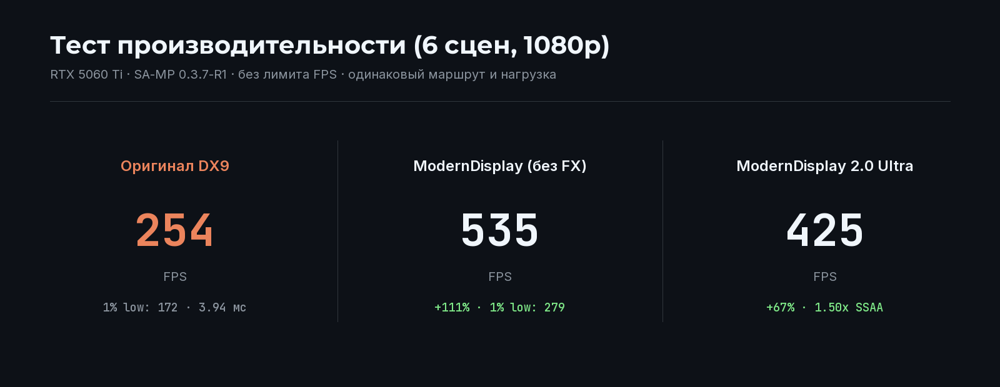
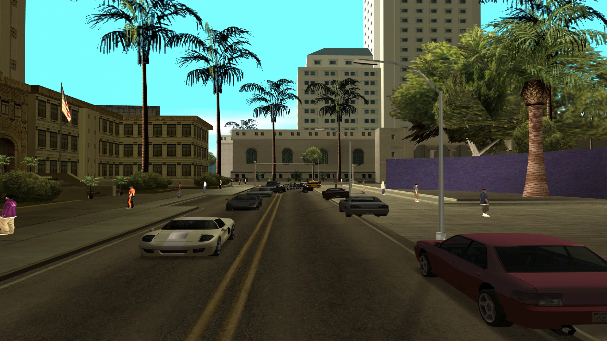
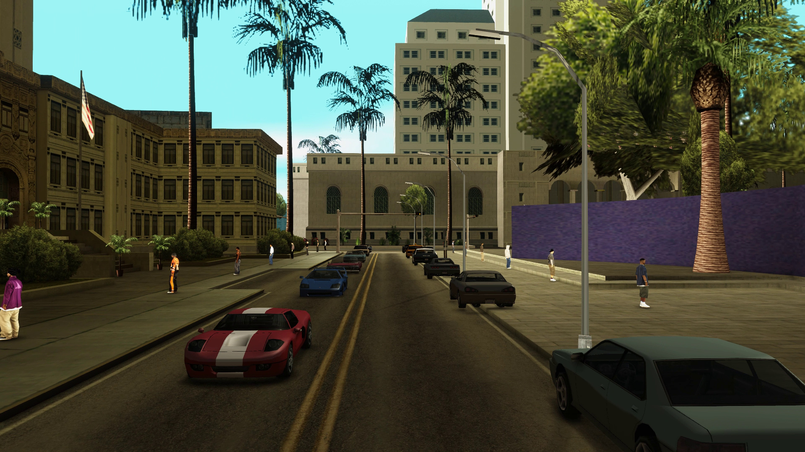
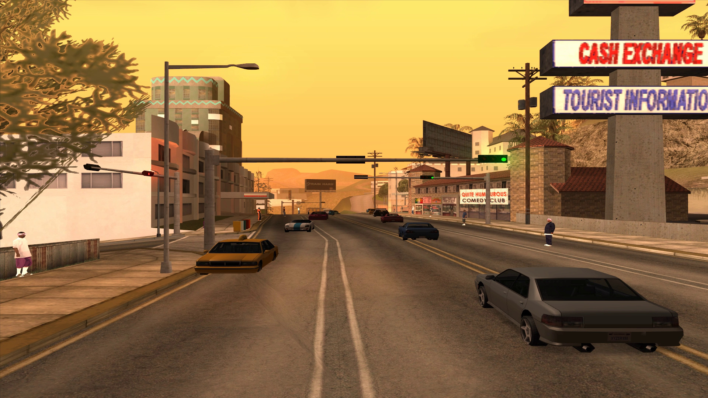
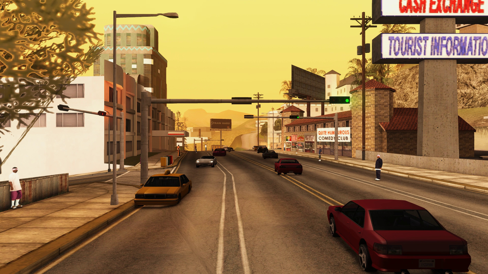
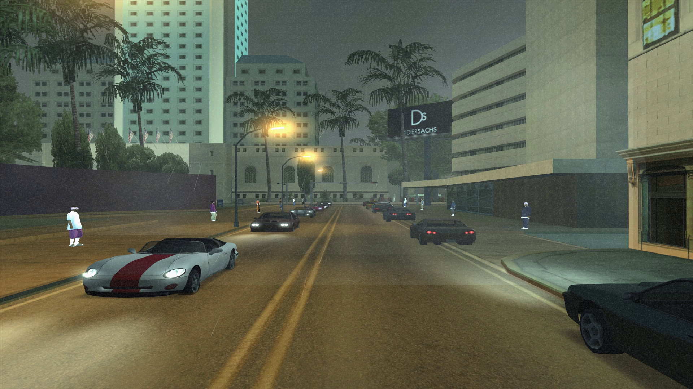
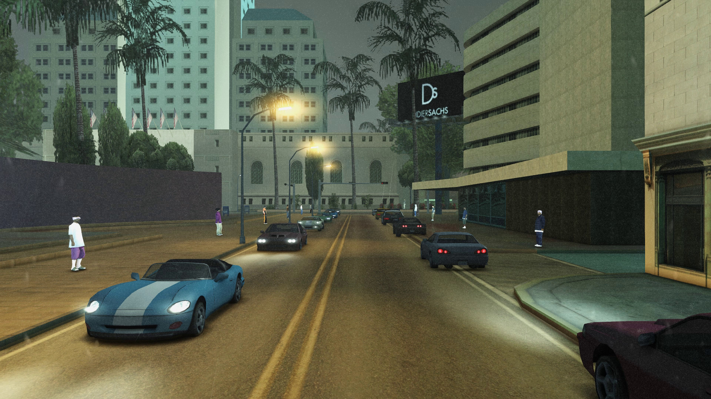
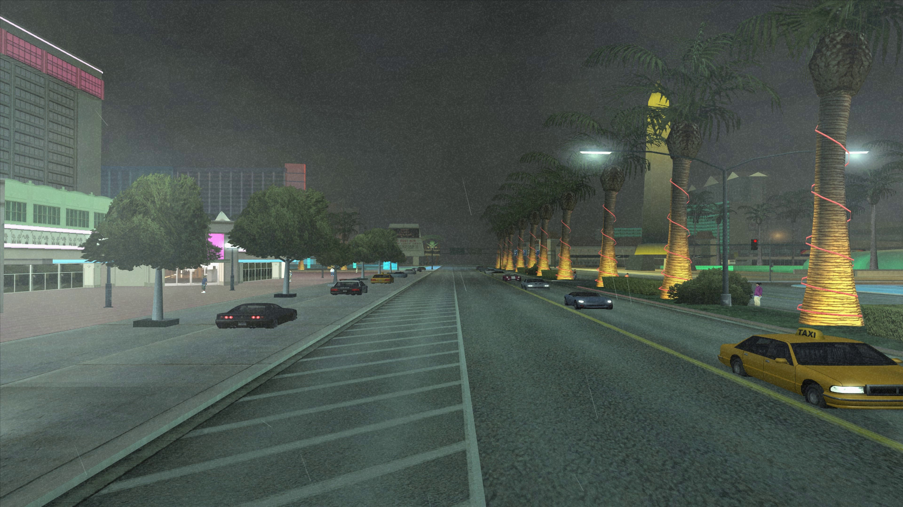
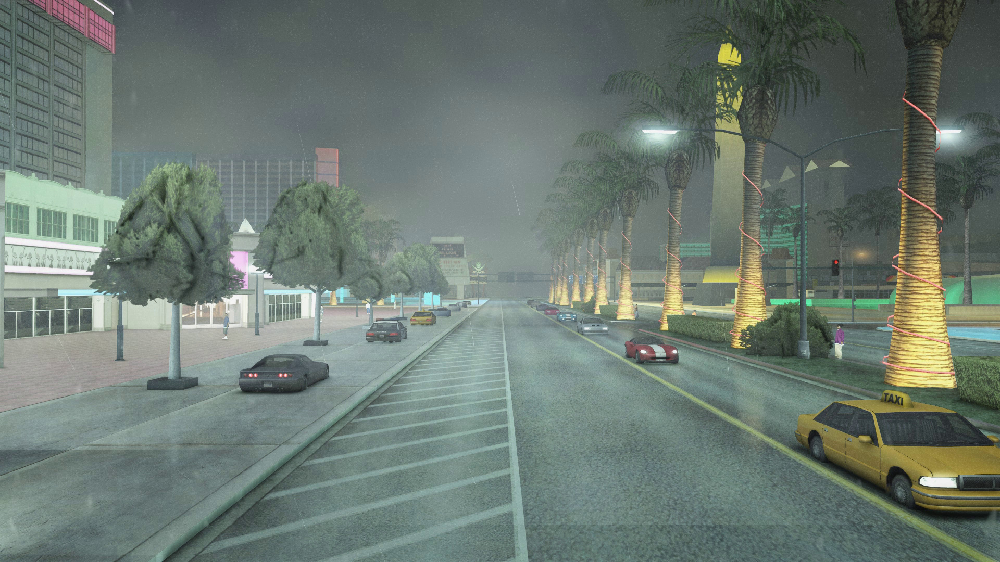

# ModernDisplay 2.0

[Русский](README.md) | **English**

Native **D3D9Ex -> D3D11 DXGI Flip Model** rendering bridge for **GTA: San Andreas 1.0 US** and **SA-MP (0.3.7 R1-R5, 0.3.DL)**.

Removes 2004 DirectX 9 bottlenecks (doubles FPS in player crowds and cuts input lag via NVIDIA Reflex / ULL-DX11) and adds a modern 3D graphics pipeline on top of the stock engine without touching 2D chat, nametags, dialogs, or HUD.


**[Watch the 1440p60 showcase video on YouTube](https://www.youtube.com/watch?v=uHZbIHgrq50)**

> **By default (without an `.ini` file)** the plugin **does not change graphics at all** - only FPS optimizations, instant Alt-Tab, and low-latency pacing are active. All visual effects can be toggled live anytime with `/md on` in-game or via `ModernDisplay.ini`.

---

## Performance

Measured on an identical deterministic 6-location route (Pershing Square, Grove Street, Downtown, Vinewood, Rainy Avenue, Las Venturas), 1920x1080, SA-MP 0.3.7-R1, uncapped FPS, RTX 5060 Ti:



| Mode | Avg FPS | 1% low | Frame time | Gain |
| --- | ---: | ---: | ---: | ---: |
| Stock DirectX 9 | 254 | 172 | 3.94 ms | baseline |
| **ModernDisplay (no visual FX)** | **535** | **279** | **1.87 ms** | **+111%** |
| **ModernDisplay 2.0 Ultra (`1.50x SSAA`)** | **425** | **281** | **2.36 ms** | **+67%** |

Where the speedup comes from:
- **D3D11 DXGI Flip Model (`FLIP_DISCARD` + `Allow Tearing`) + Async Present** - moves presentation off the game thread so the CPU never stalls on `Present()`.
- **SSE2 State Cache** - caches D3D9 states, matrices, lights, and shader constants, eliminating tens of thousands of redundant RenderWare/SA-MP driver calls per second.
- **Smart Managed Textures** - dirty-rectangle updates and skipping `D3DLOCK_READONLY` uploads (removes chat and 3D-text microstutters).
- **Async GPU Mipmaps + `DrawPrimitiveUP` Batching** - zero hitching during texture streaming.
- **NVIDIA Reflex (Boost) / Universal DX11 Low-Latency** - hardware frame markers on NVIDIA, `MaxLatency=1` + pre-input sync on AMD and Intel.
- **Instant Alt-Tab & F8 Screenshots** - zero `DeviceLost` on minimize; F8 encodes PNG in <1 ms on a background thread.

---

## Visual Effects (Before / After)

All effects run strictly on the 3D mask and Z-buffer - chat, nametags, dialogs, radar, and third-party ImGui overlays remain 100% untouched.

### 1. XeGTAO Contact Shadows, SSGI Bounce Lighting & SMAA + SSAA
Real Z-buffer Ambient Occlusion (works on NVIDIA, AMD, and Intel without NVIDIA Inspector), live color bounce from surfaces, and clean anti-aliasing without blur.

| Stock DirectX 9 | ModernDisplay 2.0 (`XeGTAO + SSGI + SMAA + 1.5x SSAA`) |
| :---: | :---: |
|  |  |

### 2. Sky, Volumetric Aerial Fog & ACES Tonemapping
Smoothly blends GTA SA's hard draw-distance edge and distant LODs into the sky color (automatically off in interiors), preventing clipped skies.

| Stock DirectX 9 | ModernDisplay 2.0 (`Aerial Fog + ACES + HDR Bloom`) |
| :---: | :---: |
|  |  |

### 3. World-Space SSR Reflections & Wet Rain FX
Reads `CWeather::Rain` and `CWeather::WetRoads` directly from game memory - wet roads and puddles reflect lamps, signs, and headlights with animated rain ripples.

| Stock DirectX 9 | ModernDisplay 2.0 (`World-Space SSR + Rain FX`) |
| :---: | :---: |
|  |  |

### 4. Night City - Full Stack (SSR + HDR Bloom + Anamorphic Flares + SSGI)
5-level Dual-Kawase HDR Bloom and subtle anamorphic flares apply exclusively to bright 3D world lights without bleeding onto UI.

| Stock DirectX 9 | ModernDisplay 2.0 (`All FX`) |
| :---: | :---: |
|  |  |

---

## Installation

- **OS:** Windows 10 / Windows 11
- **Game:** GTA:SA 1.0 US (Singleplayer or SA-MP 0.3.7 R1 / R2 / R3-1 / R4 / R5-1 / 0.3.DL-R1)

1. Download `ModernDisplay.asi` from [Releases](https://github.com/xKumorio/ModernDisplay/releases).
2. Drop `ModernDisplay.asi` into your GTA:SA root folder next to `gta_sa.exe` (or into `scripts/`).
   - **Performance-only (stock look):** nothing else needed - the plugin auto-generates a clean `ModernDisplay.ini`.
   - **English `.ini` & chat messages:** set `english=1` under `[Language]` at the top of `ModernDisplay.ini` (or type `/md lang en` in-game) - all `.ini` comments rewrite to English automatically while keeping your settings.
   - **Visual effects:** type `/md on` in-game or enable effects in `ModernDisplay.ini`.
3. Remove any third-party `d3d9.dll` (DXVK, ENB, ReShade) from the game folder to avoid conflicts.

---

## In-Game Commands (SA-MP)

Every setting updates live without restarting and saves automatically to `ModernDisplay.ini`.

| Command / Hotkey | Action |
| --- | --- |
| `/md off` / `/md on` | Instantly disable all visual FX (keep FPS boost) / restore your preset |
| `/md lang <ru\|en>` | Switch language and rewrite `ModernDisplay.ini` comments |
| `/md compare` (`Alt+F9`) | Live Before/After split-screen wipe (`fixed`, `auto`, `mouse`, `off`) |
| `/md hud` (`Alt+F10`) | Toggle minimal telemetry HUD (FPS, frametime, Reflex latency, iFlip) |
| `Alt+Enter` | Instant windowed / borderless fullscreen toggle |
| `/md ao <0..3>` | XeGTAO quality (`0` off, `1` low, `2` med, `3` high) |
| `/md aa <0..3>` | Anti-aliasing (`1` SMAA Med, `2` SMAA High, `3` SMAA T2x) |
| `/md ssr <0..2>` | Water & wet road reflections (`1` med, `2` high) |
| `/md rainfx <0\|1>` | Rain puddle reflections & ripples (with SSR) + rain FX |
| `/md raindrops <0\|1>` | Screen lens rain droplets (when `rain_fx=1`) |
| `/md rainlight <0\|1>` | Time-of-day rain lighting for weather IDs 8 & 16 (independent of SSR) |
| `/md spray <0\|1\|2>` | Wheel water spray (`0` off, `1` original, `2` reduced in standing water) |
| `/md gi <0..100>` | SSGI global illumination strength |
| `/md bloom <0..100>` | 3D HDR Bloom strength (`/md flare 0\|1` for anamorphic flares) |
| `/md fog <0..100>` | Volumetric Aerial Perspective fog strength |
| `/md tonemap <0\|1\|2>` | Tonemapping (`0` off, `1` ACES Filmic, `2` AgX Punchy) |
| `/md ssaa <1.0..2.0>` | Internal SSAA supersampling + Catmull-Rom downscale |
| `/md fps <0\|auto\|20..1000>` | Precision FPS cap (`auto` = monitor Hz - 3 for G-Sync/FreeSync) |
| `/md reflex <off\|on\|boost>` | NVIDIA Reflex / ULL-DX11 low-latency mode |
| `/md lut <name\|list\|off>` | Load a `.cube` 3D LUT from `ModernDisplay\luts\` |

`ssgi_display_res=1` evaluates SSGI at display resolution under SSAA. `compressed_mip_cache=1` caches compressed DXT mip levels in `ModernDisplay/mip-cache-v2`. `direct_render_targets=1` enables experimental shared render targets with async present (when MSAA=0 and `D3DSWAPEFFECT_DISCARD`). All three are off by default.

---

## Building from Source

Requires Visual Studio 2022 Build Tools with C++ x86 workload (Windows 10/11 SDK):

```bat
build.bat
```

Output binary: `build\ModernDisplay.asi`.

---

## Links

- **BlastHack Thread:** https://www.blast.hk/threads/259505/
- **Author:** Softik Inquisitor - https://vk.ru/miurawr
